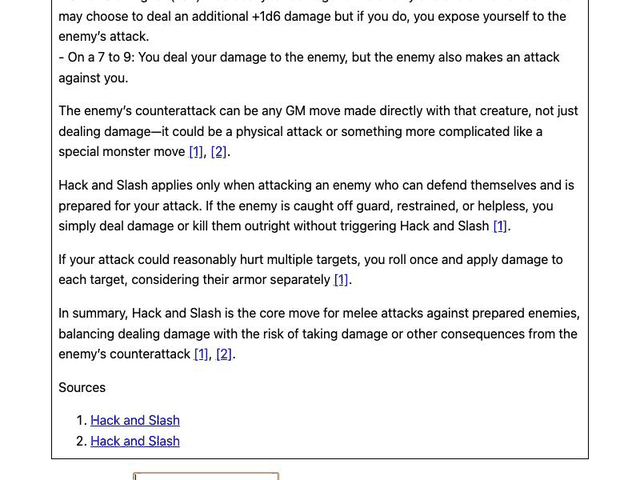

# dw-companion

An unofficial [Dungeon World](https://github.com/Sagelt/Dungeon-World) rules site with an AI assistant for players and GMs at the table.

## The problem

Dungeon World is played fiction first: a player describes what their character does, and the table decides whether that triggers a move, which one, which stat to roll and what a 10+, 7–9 or 6- means. Mid-session that means someone leafing through the rulebook while everyone waits, or arguing from memory about what a move actually says. dw-companion puts the complete rules text online as linkable pages and adds an assistant that helps in two ways. It answers rules questions with links to the exact section it relies on. Given what a character does, it says which move is triggered (if any), why, and what each outcome means, and it can roll the dice. It is also a portfolio project in production-minded AI engineering. Every AI step is measured by evals, traced, budgeted, and kept away from the jobs that plain code does better.

## Live demo

**Live demo:** <https://dw-companion.procionegobbo.it/>. The rules are at `/`, the assistant at `/assistant/`.



Things to try on `/assistant/`: "How does Hack and Slash work?", "I hold the door shut while the ghouls pound on it", "I tell the innkeeper my name". Tick "Roll the dice for me" to have the assistant roll.

The demo runs on a small budget: 5 messages per minute and 50 per day per visitor, and a global daily spending cap. When the cap is reached the assistant says so, and the rules pages keep working. Limits reset at 00:00 UTC.

## What the assistant does (and what it doesn't do with AI)

A router (a small LLM call with structured output) sorts every message into one of three intents.

- **Rules question.** Hybrid retrieval (embeddings plus BM25 keyword search) finds the most relevant rulebook sections. The answer model must answer only from those sections and cite them by section id, and every surviving citation becomes a link to the exact rules page.
- **Action description.** A classifier gets the description together with all 21 basic and special moves (the whole list every time, not a retrieved subset). It returns the move, a confidence and a rationale. "No move" is a first-class answer, because in Dungeon World plenty of actions trigger nothing. When the classifier is not confident, the assistant asks one clarifying question instead of guessing. Otherwise it explains why the trigger matches and shows a move card with the stat and the outcome bands, and it rolls if asked.
- **Anything else** gets a short fixed reply saying what the assistant can do, with no further model calls.

### Deliberately not AI

| Job | Done by | Why |
|---|---|---|
| Rolling dice | [`backend/domain/dice.py`](backend/domain/dice.py): `2d6 + modifier`, banded into 10+ / 7–9 / 6-. The modifier comes from what the user typed, never from model output. | A model must never invent a result. Code is exact, free, and unit-tested with seeded randomness. |
| Outcome text | Quoted verbatim from the structured data parsed from the rulebook, and shown on the move card, never in the model's prose. When a move does not state a miss, the card says "Not stated by this move." | The rulebook is the authority, and paraphrased outcomes drift. Most moves leave the miss to the GM, so the assistant does not invent one. |
| Validating citations | [`backend/graph/citations.py`](backend/graph/citations.py): any cited section that was not actually retrieved is stripped and the event is traced. If no valid citation remains, the reply is "I couldn't find this in the rules." plus links to the closest sections. | A hallucinated citation can never reach the user. This is the main anti-hallucination signal, and the evals measure it as citation validity. |
| Choosing the stat to roll | Taken from the move's data, overriding the classifier when they disagree. | Structured data beats model output wherever both exist. |
| Clarifying questions, "no move" and out-of-scope replies | Fixed templates. | Zero cost and latency, and fully testable. |

## Architecture

```
Sagelt/Dungeon-World XML (git submodule, pinned commit)
        │ ingestion/ (Python, offline)
        ▼
data/normalized/*.json (sections, moves, classes; committed)
        │                                       │
        │ index build (offline, embeddings)     │ Astro build
        ▼                                       ▼
data/index/ (vectors + chunks; committed)      site/dist/ (rules pages + /assistant/ widget)
        └──────────────────┬────────────────────┘
                           ▼ one container image
             Cloud Run, single instance
             ├─ /            static rules site
             ├─ GET  /api/health
             └─ POST /api/chat ─▶ guardrails ─▶ LangGraph assistant ─▶ OpenRouter (LLMs, embeddings)
                                                        └─▶ Langfuse (model, tokens, cost, latency, intent)
```

```
router ─┬─ rules_question ─────▶ retrieve ─▶ answer_with_citations ─▶ citation_validator ─▶ cited answer | "couldn't find this"
        ├─ action_description ─▶ classify_move ─┬─ low confidence ─▶ clarifying question (template)
        │                                       ├─ no_move ────────▶ "No move is triggered" + rationale
        │                                       └─ move ───────────▶ explain ─▶ [roll ─▶ outcome]
        └─ out_of_scope ───────▶ fixed reply
```

1. **Request.** The widget posts the message to `/api/chat` on the same origin. Before any model call, the API checks the size, the input and the spend cap, then the rate limit. It then streams progress events (Server-Sent Events) while the graph runs, and sends the validated reply at the end. Tokens are not streamed, because the answer can only be shown after its citations are checked.
2. **Router.** The router picks the intent. It runs on a small model with a JSON schema at temperature 0.
3. **Rules branch.** It retrieves the top sections, generates an answer with inline section-id citations, then the deterministic validator keeps only citations from the retrieved set.
4. **Move branch.** It classifies against the full move list, then either asks for clarification, answers "no move", or explains the move. An optional roll and outcome come from domain code.
5. **Every node is traced** in Langfuse, with model, tokens, cost, latency and intent, under a random session id. Any provider failure or malformed model output ends the turn with a fixed error reply.
6. **Ports and adapters.** `backend/domain` holds pure types and dice. `backend/ports` holds the interfaces, `backend/adapters` the OpenRouter, retrieval, Langfuse and JSON implementations, `backend/graph` the LangGraph nodes and `backend/api` FastAPI. The whole graph is tested against fakes, so CI never calls a paid API. Each role (router, classifier, answer, embeddings) reads its model id from the environment.

Node-by-node details are in [`docs/architecture.md`](docs/architecture.md). To run everything locally, see [`docs/development.md`](docs/development.md).

## Evaluation

Three hand-labelled datasets live in [`evals/datasets/`](evals/datasets/): router messages (including mixed and adversarial ones), rules questions (including questions the rules do not answer), and action descriptions covering every basic and special move, ambiguous pairs and actions that trigger no move. The labels are written or reviewed by the project owner, an experienced GM. They are never generated by the model under test, and the runner refuses to run on any row not marked as reviewed. See [`evals/README.md`](evals/README.md).

### Results

Configuration `classifier-mini`: router `openai/gpt-4.1-nano`, classifier `openai/gpt-4.1-mini`, answer `openai/gpt-4.1-mini`, embeddings `openai/text-embedding-3-small`, report [`evals/reports/2026-11-10-classifier-mini.md`](evals/reports/2026-11-10-classifier-mini.md), run on 2026-11-10.

| Metric | What it measures | Cases | Result |
|---|---|---|---|
| Router accuracy | Messages sent to the right branch: rules question, action or out of scope. | 45 | 84.4% |
| Retrieval recall@6 | Share of the expected rulebook sections found among the 6 retrieved. | 36 | 100.0% |
| Citation validity | Citations that point to a section actually retrieved. Invalid ones are stripped before the user sees them. | 45 | 100.0% |
| Key-fact coverage | Required facts present in the answer, scored by an LLM judge with a written rubric. The judge model differs from the answer model. | 36 | 94.2% |
| Correct refusals | Questions the rules do not answer where the assistant said so instead of inventing an answer. | 9 | 11.1% |
| Move accuracy | Actions classified as the expected move, or as an accepted alternative for genuinely ambiguous cases. | 86 | 87.2% |
| `no_move` precision | When the assistant says "no move", how often that is right. | — | 100.0% |
| `no_move` recall | Of the actions that trigger no move, how many it recognised. | 16 | 56.2% |
| Clarification rate | Actions where it asked a clarifying question instead of answering. | 86 | 0.0% |

### Configuration comparison

Measure before you trust: the tuning round runs configurations on the same reviewed datasets, with the same judge and on the same commit. It then decides with a rule written before seeing the numbers. The cheaper configuration is kept unless the more expensive one meets all three conditions. First, its targeted metric improves by more than two cases' worth. Second, on that metric's dataset, the cases it alone gets right outnumber the cases only the cheaper one gets right by at least 3. Third, no other headline rate regresses by more than two cases' worth. The owner may override the outcome only with a recorded reason. The full rule is in [`evals/README.md`](evals/README.md#tuning-round).

<!-- comparison-table:start -->
| Metric | Cases | baseline | classifier-mini | Δ |
| --- | --- | --- | --- | --- |
| Router accuracy | 45 | 84.4% | 84.4% | +0.0 pp |
| Retrieval recall@6 | 36 | 100.0% | 100.0% | +0.0 pp |
| Citation validity | 45 | 100.0% | 100.0% | +0.0 pp |
| Key-fact coverage | 36 | 93.3% | 94.2% | +0.9 pp |
| Correct refusals | 9 | 22.2% | 11.1% | -11.1 pp |
| Move accuracy | 86 | 60.5% | 87.2% | +26.7 pp |
| no_move precision | — | 80.0% | 100.0% | +20.0 pp |
| no_move recall | 16 | 25.0% | 56.2% | +31.2 pp |
| Clarification rate | 86 | 2.3% | 0.0% | -2.3 pp |
| Cost per query | 176 | $0.00048 | $0.00102 | +$0.00055 (+115%) |
| Cost per rules question | 68 | $0.00084 | $0.00171 | +$0.00087 (+104%) |
| Cost per action description | 87 | $0.00031 | $0.00070 | +$0.00039 (+129%) |
| Latency p50 | 176 | 3409 ms | 3316 ms | -93 ms |
| Latency p95 | 176 | 5142 ms | 5592 ms | +450 ms |
<!-- comparison-table:end -->

Chosen: `classifier-mini`. Move accuracy improved 26.7 pp on 86 cases with candidate-only flips far outnumbering reference-only flips, and no other headline rate regressed beyond one case's worth of noise, so the decision rule was met. Full comparison: [`evals/reports/comparisons/2026-11-10-baseline-vs-classifier-mini.md`](evals/reports/comparisons/2026-11-10-baseline-vs-classifier-mini.md); decision record: [ADR-018](docs/decisions.md).

### Reproduce

With an OpenRouter key and Langfuse keys in `.env` (see [`docs/development.md`](docs/development.md)):

```
make eval                                         # every dataset, baseline config, default budget guard
make eval CONFIG=<name> DATASET=router BUDGET=1.50
make compare REPORTS="evals/reports/<reference>.json evals/reports/<candidate>.json"
```

The runner estimates the cost from live prices before any paid call and aborts above the budget. Each run writes a JSON report and a Markdown summary to `evals/reports/` and is traced in Langfuse with its configuration. The GitHub workflow "Evals" runs the same command, but only on manual dispatch.

## Cost, latency and guardrails

Source: [`evals/reports/comparisons/2026-11-10-baseline-vs-classifier-mini.md`](evals/reports/comparisons/2026-11-10-baseline-vs-classifier-mini.md), configuration `classifier-mini`.

| Measure | Value |
|---|---|
| Cost per query | $0.00102 |
| Cost per rules question | $0.00171 |
| Cost per action description | $0.00070 |
| Latency p50 | 3316 ms |
| Latency p95 | 5592 ms |

Costs are the ones the provider reports per call (OpenRouter `usage.cost`), summed per turn and averaged over all eval cases. The eval judge is excluded. An out-of-scope message costs one router call. Latencies are whole-turn wall-clock times from the eval runner, which runs cases one at a time. They are not production measurements.

Guardrails, all enforced before any model call unless noted:

- **Input limits.** Messages are at most 500 characters and request bodies at most 16 KiB. Validation is strict and rejects unknown fields.
- **Rate limit per visitor.** 5 messages per minute and 50 per day. Visitors are keyed by a salted hash of the IP and never by the raw address.
- **Daily spend cap.** A global $1.00 per UTC day, counted from provider-reported cost. Past the cap the API answers "The demo budget is used up for today. Please come back tomorrow. The rules pages still work in the meantime."
- **Bounded calls.** Every model call has `max_tokens` (router 100, classifier 400, answer 700, explanation 300), and each turn times out after 60 s. A turn makes at most three model calls.
- **One instance.** Limits and the spend counter live in memory. The service runs with `max-instances=1` so there is one ledger. The counters reset on deploy or restart, so the hard bounds are a credit limit on the OpenRouter key and a GCP budget alert ([ADR-015](docs/decisions.md), [ADR-019](docs/decisions.md)).
- **Prompt injection, handled proportionately.** The assistant has no tools and no sensitive data. User text is delimited and declared as data in every prompt, off-topic requests get a fixed reply, and the widget renders model text as plain text with links built only from known section ids.
- **Privacy.** IPs never reach traces or logs, and sessions use a random id per page load. Messages and answers are sent to Langfuse for tracing.
- **Evals.** The runner has its own budget guard (default $3 per run). Pull-request CI calls no paid API.

## Trade-offs and decisions

Every decision is logged in [`docs/decisions.md`](docs/decisions.md). The main ones:

- **Deterministic where it matters.** Dice, outcome text, the rolled stat and citation validation are plain code. The model routes, classifies and writes prose. The assistant cannot improvise a miss that a move does not state, and in exchange its correctness can be unit-tested ([ADR-011](docs/decisions.md), [ADR-009](docs/decisions.md)).
- **The source text wins.** Where the project brief and the rulebook disagreed (most moves state no miss), the book was followed. The source is a pinned submodule and is never hand-copied ([ADR-008](docs/decisions.md), [ADR-003](docs/decisions.md)).
- **No managed vector database.** One rulebook is a few hundred section chunks. A NumPy matrix plus in-house BM25, fused with reciprocal rank fusion, is built offline, committed and baked into the image. There is no server and no bill, but changing the index needs a rebuild and a deploy. Keyword search is there because game terms like "Hack and Slash" or "hold" are matched better by exact words than by embeddings ([ADR-014](docs/decisions.md)).
- **One gateway for models.** OpenRouter serves both chat and embeddings with one key and reports the cost of every call. Model ids come from the environment, so swapping a model is a configuration change ([ADR-013](docs/decisions.md)).
- **Model choice by measurement.** See [Evaluation](#evaluation).
- **Progress streaming, not token streaming.** The answer is shown only after its citations are validated, so a stripped citation is never flashed on screen. The cost is perceived latency ([ADR-015](docs/decisions.md)).
- **In-memory limits on a single always-on instance.** There is no Redis or Firestore. `max-instances=1` keeps one spend ledger, and the default `min-instances=1` stops scale-to-zero from resetting the cap, at the price of an idle instance ([ADR-019](docs/decisions.md)).
- **One container, one origin.** The API serves the static site, so the widget calls a relative `/api/chat` with no CORS and no build-time URL ([ADR-016](docs/decisions.md), [ADR-019](docs/decisions.md)).
- **Static site with stable URLs.** Page URLs derive from section ids, never from titles, because citations depend on them ([ADR-010](docs/decisions.md), [ADR-007](docs/decisions.md)).
- **Tracing never blocks a reply.** Langfuse export is asynchronous and failures are swallowed ([ADR-012](docs/decisions.md)).
- **Humans label, CI doesn't spend.** Eval labels are owner-reviewed, the judge model differs from the answer model, and evals run only on manual dispatch with a budget guard ([ADR-017](docs/decisions.md), [ADR-006](docs/decisions.md)).
- **Single-turn conversations.** There is no memory between messages, so answering a clarifying question means restating the action. That keeps prompts and evals simple ([ADR-011](docs/decisions.md)).

## What I'd do next

These were deliberately left out of scope:

- **Class moves in the classifier.** They are already searchable through rules answers. Classifying them needs to know which class the character is, and that is character state the assistant does not have.
- **Character sheets, persistent sessions, multiplayer and login.**
- **An "AI GM"** that runs a game. The assistant supports the people at the table and does not replace the GM.
- **Fine-tuning.** Prompting, routing and evals are enough at this scale.
- **Translation of the rules text.**
- **Answering in the user's language** (a nice-to-have). An Italian question would get an Italian answer, with citations still pointing to the English text, and a handful of eval cases would prove it works.

## Attribution

This project uses the text of **Dungeon World** by Sage LaTorra and Adam Koebel, from <https://github.com/Sagelt/Dungeon-World>, licensed under [CC BY 3.0](https://creativecommons.org/licenses/by/3.0/). The text has been adapted (parsed and reformatted). This project is **unofficial** and not endorsed by the authors. No art, logos or trade dress from the commercial book are used. The upstream licence also carries an SRD 5.1 notice (CC BY 4.0), which is reproduced with the full credits in [`ATTRIBUTION.md`](ATTRIBUTION.md).

Licensing is split: the **code** is [MIT](LICENSE), and the **rules text** remains CC BY 3.0 ([ADR-004](docs/decisions.md)).
